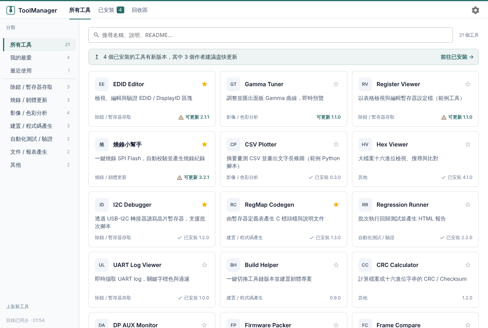
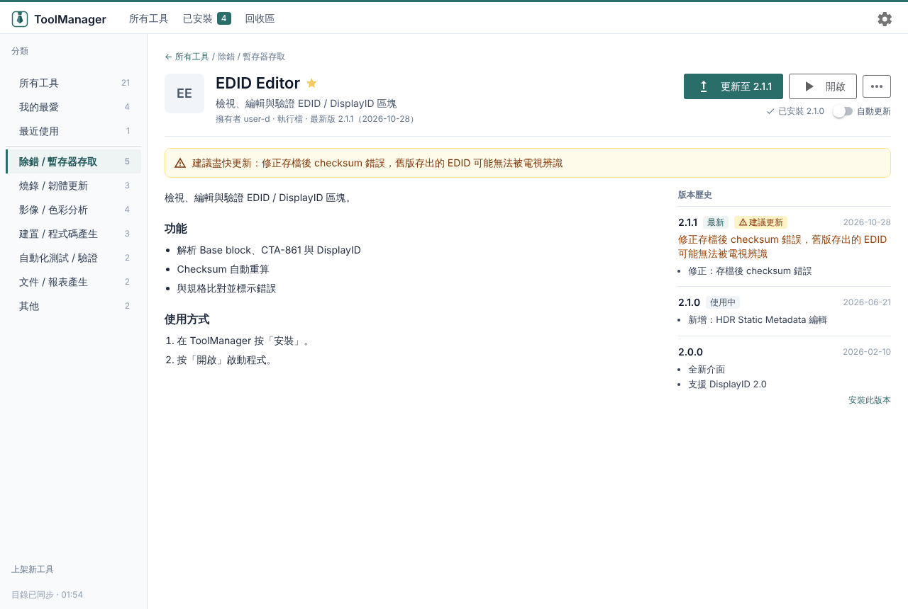
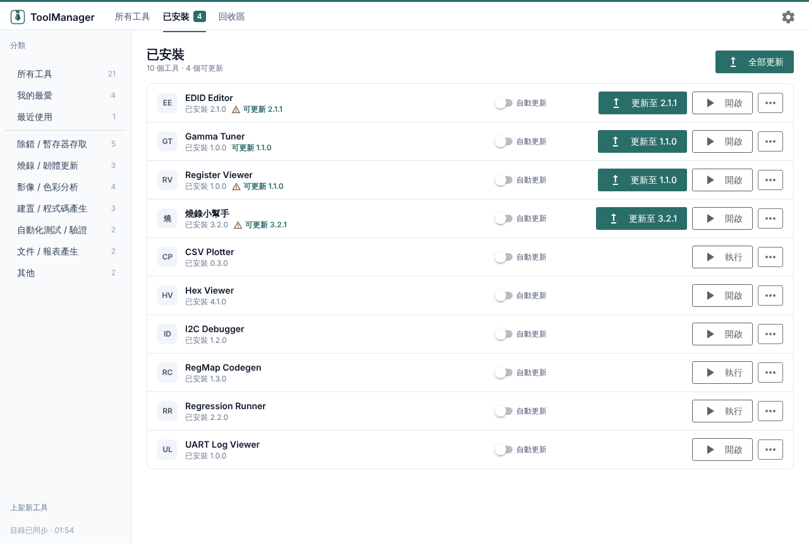
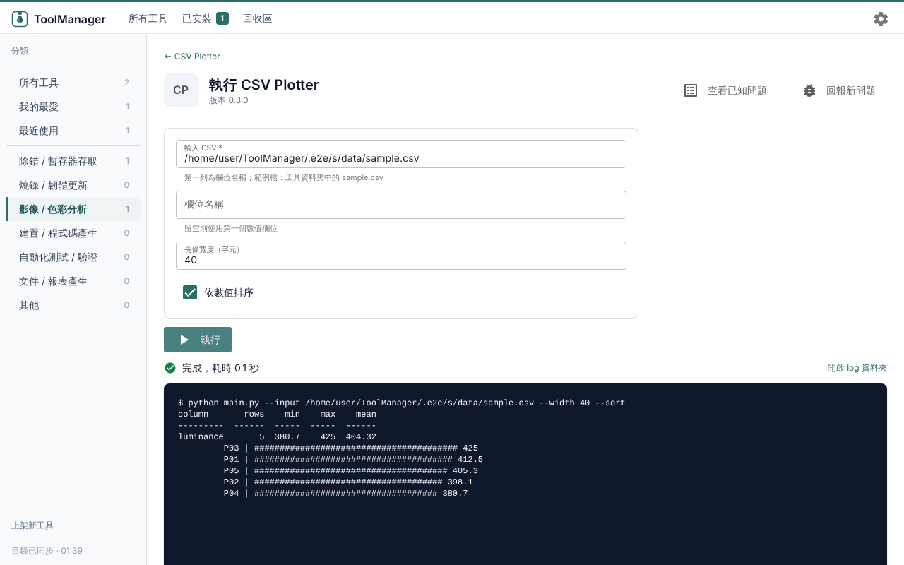
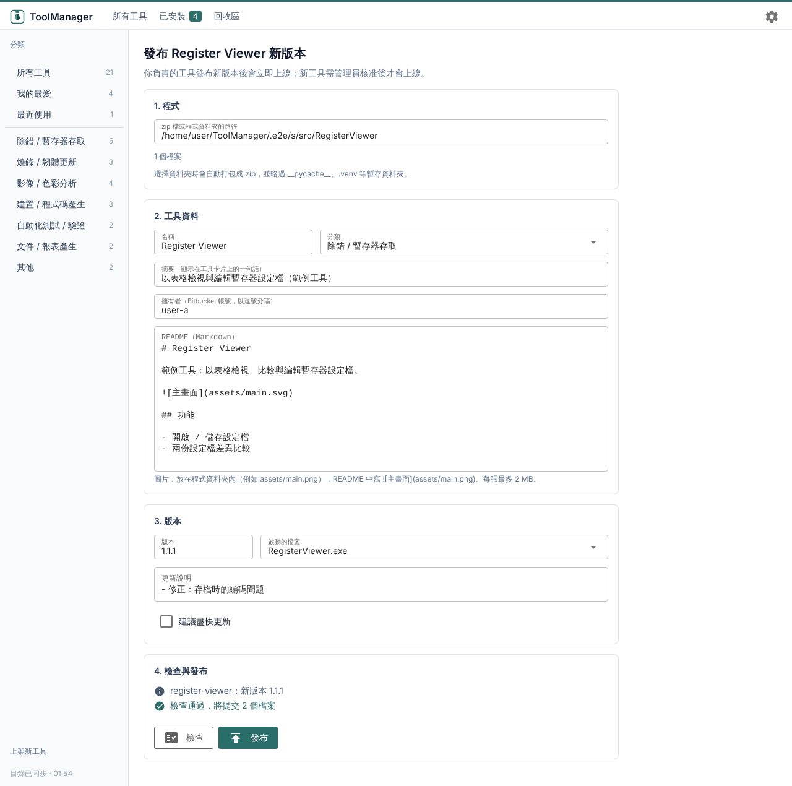

# ToolManager

部門內部工具的 Marketplace：瀏覽、搜尋、一鍵安裝 / 更新 / 回退、執行與發布工具。

- 功能說明（提案用）：[FEATURE.md](FEATURE.md)
- 設計文件：[docs/DESIGN.md](docs/DESIGN.md)
- P0 技術驗證清單：[docs/P0.md](docs/P0.md)
- 客戶簡化版：[docs/CUSTOMER.md](docs/CUSTOMER.md)
- 使用手冊：[docs/USER_GUIDE.md](docs/USER_GUIDE.md)
- 作者手冊（上架工具）：[docs/AUTHOR_GUIDE.md](docs/AUTHOR_GUIDE.md)

## 介面一覽

> 以下為範例 catalog（`examples/catalog`）在開發模式下的畫面。Windows 上是獨立的桌面視窗，內容相同。

### 工具目錄

左側依分類瀏覽，也有「我的最愛」和「最近使用」；上方可以搜尋名稱、說明與 README。已安裝的工具有新版本時，頂部會提醒，卡片上也會標示「可更新」。



### 工具詳情

顯示 README、擁有者與「版本歷史」（每個版本的更新說明）。右上角可以安裝、更新、開啟；「⋯」選單有切換回上一版、開啟安裝資料夾、查看已知問題、回報新問題、移除。作者標示為重要的更新會以琥珀色提示並附原因。



### 已安裝

所有已安裝的工具和版本，可以逐一或「全部更新」，也可以為個別工具打開「自動更新」。



### 執行 Python 工具

作者在發布時定義的參數會顯示成表單，填好後按「執行」，下方即時顯示輸出。使用者不需要自己安裝 Python 或套件。



### 發布精靈

只有對 catalog repo 有寫入權限的開發人員看得到。選擇程式（zip 或資料夾）、填寫工具資料與版本說明，按「檢查」確認沒問題後「發布」。你負責的工具發布新版本後立即上線；新工具會送管理員審核。



## 開發

需求：Python 3.12、[uv](https://github.com/astral-sh/uv)

```bash
uv sync
uv run pytest -q
uv run ruff check .

# 以範例 catalog 啟動（Windows 為原生視窗；--browser 改用瀏覽器）
uv run toolmanager --catalog examples/catalog

# 修改範例 release.toml 後，重新產生範例 zip
uv run python scripts/make_example_artifacts.py
```

## 專案結構

```
src/toolmanager/
  core/       業務邏輯（不依賴 UI）：models、manifest、catalog_cache、installer、repository、env …
  backends/   Repository 實作：local（開發用）、bitbucket_server
  ui/         NiceGUI 介面：state（狀態與動作）、theme（字型、版面框架）、widgets、pages、setup_pages
  i18n/       翻譯檔
launcher/           C++ launcher（ToolManager.exe），見 launcher/README.md
installer/          Inno Setup 安裝程式腳本，見 installer/README.md
examples/catalog/   範例 catalog
scripts/            打包與 P0 驗證腳本
tests/              pytest
```

組織相關的設定（Bitbucket 網址、PyPI mirror 等）只存在於使用者的 `settings.toml`，不進入版本控制。
